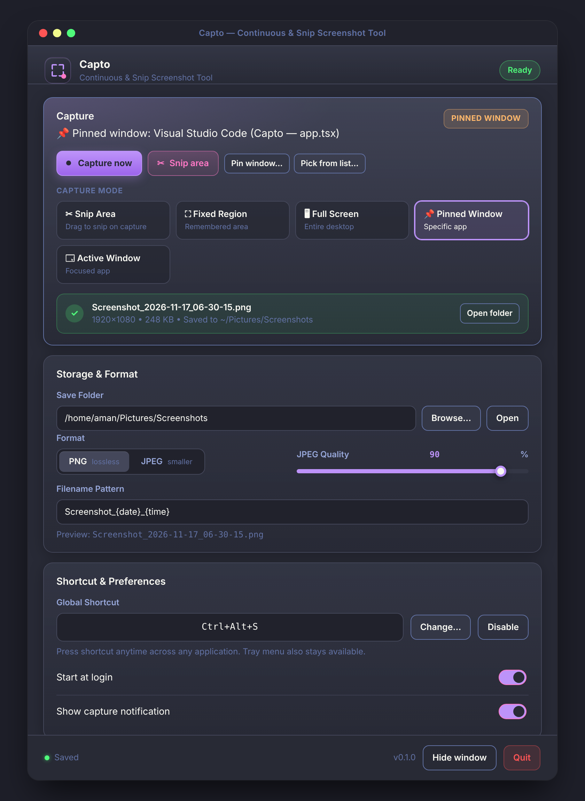
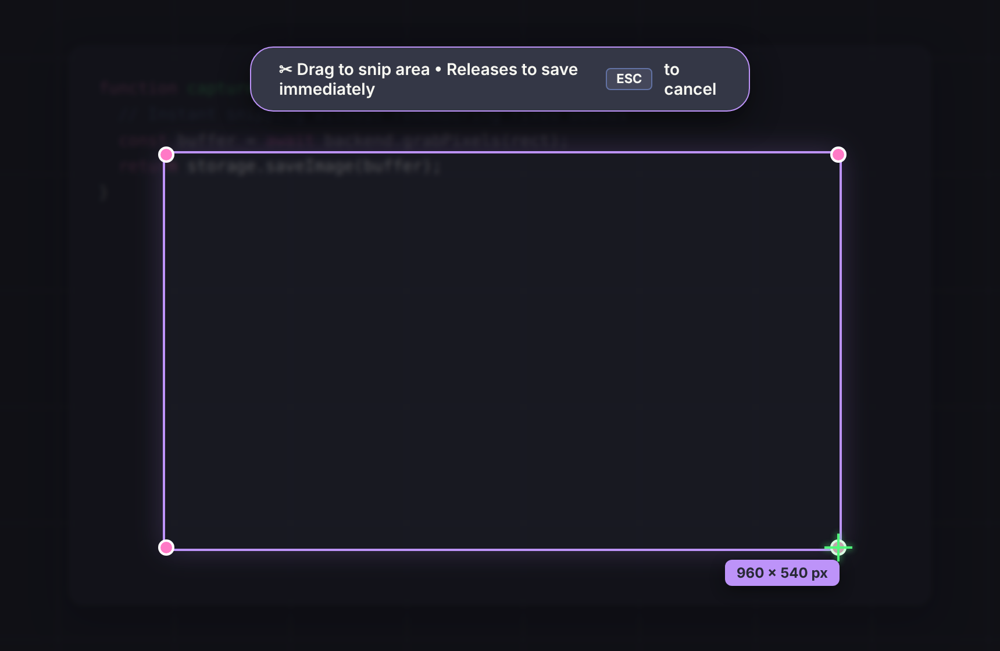
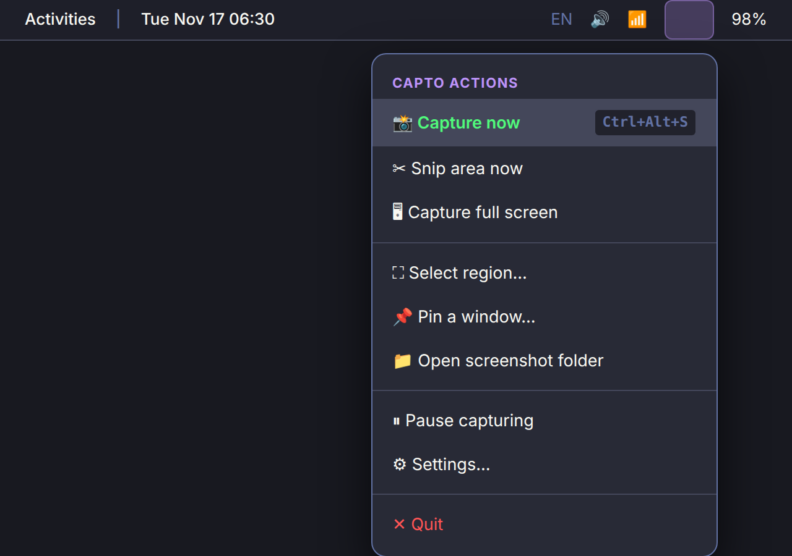
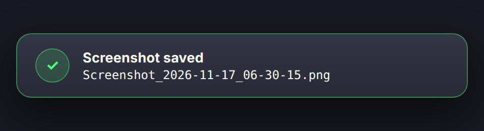

# Capto 📸

A lightweight, tray-resident continuous screenshot and snipping tool for Linux. Designed for developers, QA engineers, and power users who need to capture screens, fixed areas, or application windows repeatedly without interrupting their workflow.

Capto runs quietly in the system tray and triggers only when you ask — via a global shortcut or the tray menu. It supports instant area snipping as well as continuous captures of fixed coordinates or backgrounded windows.

<p align="center">
  
</p>

---

## ✨ Features at a Glance

### 1. Flexible Capture Modes
Capto adapts to whatever testing or documentation task you are performing:

| Mode | Icon | How It Works | Ideal For |
|---|:---:|---|---|
| **Snip Area** (`select_area`) | ✂ | Interactive crosshair overlay appears on trigger; dragging a rectangle immediately saves the screenshot on mouse release. | One-off captures of varying screen portions. |
| **Fixed Region** (`region`) | ⛶ | Saves target rectangle coordinates once. Later captures re-shoot the exact same coordinates instantly without re-prompting. | Monitoring changing logs, UI component states, or dashboards. |
| **Full Screen** (`full_screen`) | 🖥 | Instantly captures the entire desktop display. | Overview screenshots and multi-monitor setups. |
| **Pinned Window** (`pinned_window`) | 📌 | Click an application window once (or pick it from a list) to lock on to it. Later captures target that window even if it is obscured, behind other apps, or unfocused. | Capturing an app while typing notes or running tests in another window. |
| **Active Window** (`foreground_window`) | 🗔 | Automatically captures whatever window has keyboard/mouse focus at the moment of capture. | Rapid multi-window documentation without manual target selection. |

<p align="center">
  
</p>

---

### 2. Tray-First & Unobtrusive
Capto lives in your desktop panel and stays out of your way until needed:
* **Crisp Camera Tray Icon**: High-contrast, transparent camera silhouette with Dracula accents, clearly legible on both dark and light panels.
* **Instant Tray Triggers**: Right-click the tray icon to quickly **Capture now**, **Snip area now**, **Capture full screen**, or switch modes.
* **Pause & Resume**: Temporarily halt capturing with a single click from the tray or UI.

<p align="center">
  
</p>

---

### 3. Dracula Theme & Clean, Modern UI
* **Authentic Dracula Palette**: Carefully styled with Dracula dark tones (`#282a36`, `#343746`, `#44475a`, `#bd93f9`, `#ff79c6`, `#50fa7b`).
* **Visual Mode Chips**: Clean, compact selector cards replace verbose forms.
* **Contextual Actions**: Secondary setup buttons (e.g. *Select region…*, *Pin window…*, *Pick from list…*) dynamically appear only when relevant to the chosen mode.
* **Seamless Auto-Save**: Any change to modes, folders, formats, or hotkeys auto-saves to disk with a subtle footer indicator—no manual "Save" button required.
* **Collapsible Diagnostics**: Display server and backend details are tucked into an expandable section at the bottom so they do not clutter everyday usage.

---

### 4. Storage, Formats & Collision-Safe Naming
* **Lossless PNG & Compressed JPEG**: Choose between pristine lossless PNG or adjustable-quality JPEG (1–100%) with an interactive slider.
* **Custom Filename Patterns**: Format file names with customizable timestamp and mode tokens:
  * `{date}`: `2026-11-17`
  * `{time}`: `06-30-15`
  * `{datetime}`: `2026-11-17_06-30-15`
  * `{mode}`: `region`, `window`, or `fullscreen`
* **Zero Overwrites**: Existing files are never replaced. If multiple captures occur within the same second, Capto automatically appends numeric suffixes (`_1`, `_2`, …).
* **Direct Folder Access**: Open the screenshot folder directly from the main UI, the tray menu, or the confirmation toast.

---

### 5. Global Hotkeys & Feedback
* **Customizable Accelerator**: Set your favorite global shortcut (default: `Ctrl+Alt+S`) using the built-in key recorder.
* **Conflict Safe**: If a shortcut combination is already registered by another application, Capto keeps the previous binding, notifies you with a plain-language explanation, and keeps the tray menu active.
* **Confirmation Toast**: Optional, sleek notification popover confirming file path and dimensions upon capture.

<p align="center">
  
</p>

---

## 🖥 Platform Compatibility

* **Current Support: Linux (X11)**.
* **Compositor Recommended**: Capturing covered or backgrounded pinned windows requires a compositing manager (e.g., Mutter, Muffin, KWin, picom). If no compositor is running, Capto safely reports that the obscured window cannot be captured without capturing overlying pixels.
* **AppIndicator / StatusNotifier**: A desktop environment with system tray indicator support is required for the tray icon (GNOME with AppIndicator extension, KDE Plasma, Cinnamon, Xfce).
* **Wayland**: Pure Wayland is currently not supported for direct pixel grabbing; an X11 or XWayland session is recommended. See [docs/COMPATIBILITY.md](docs/COMPATIBILITY.md) for detailed environment test results.

---

## 🚀 Building & Installation

Capto is built with [Tauri v2](https://tauri.app/) and Rust.

### System Prerequisites

#### Debian / Ubuntu
```bash
sudo apt update
sudo apt install build-essential curl wget file libssl-dev pkg-config \
  libgtk-3-dev libwebkit2gtk-4.1-dev libayatana-appindicator3-dev \
  librsvg2-dev libxdo-dev patchelf
```

#### Fedora
```bash
sudo dnf install gcc-c++ make webkit2gtk4.1-devel openssl-devel \
  libappindicator-gtk3-devel librsvg2-devel libxdo-devel patchelf
```

#### Arch Linux
```bash
sudo pacman -S --needed base-devel webkit2gtk-4.1 libappindicator-gtk3 \
  librsvg patchelf
```

### Install Rust & Tauri CLI
Ensure Rust 1.90 or newer is installed:
```bash
curl --proto '=https' --tlsv1.2 -sSf https://sh.rustup.rs | sh
cargo install tauri-cli --version "^2" --locked
```

### Run & Build

```bash
# Run in development mode
cargo tauri dev

# Build release bundles (.deb and .AppImage)
cargo tauri build
```

Release binaries and packages are generated in `target/release/bundle/deb/` and `target/release/bundle/appimage/`. The standalone release binary is `target/release/capto`.

---

## 📂 Configuration & File Locations

Capto follows the XDG Base Directory specification:

| File | Location | Description |
|---|---|---|
| **Settings** | `~/.config/io.github.capto/settings.json` | Persistent configuration (mode, paths, quality, shortcuts) |
| **Log File** | `~/.config/io.github.capto/capto.log` | Rotated application event and error log (max 512 KB) |
| **Autostart** | `~/.config/autostart/capto.desktop` | Standard XDG desktop entry for start-at-login |
| **Default Screenshots** | `~/Pictures/Screenshots` | Default output directory |

### Example `settings.json`
```json
{
  "version": 1,
  "mode": "select_area",
  "region": { "x": 100, "y": 100, "width": 800, "height": 600 },
  "window": {
    "window_id": 4194325,
    "title": "Notes — draft.txt",
    "class": "gedit",
    "pid": 12345
  },
  "output_dir": "/home/user/Pictures/Screenshots",
  "format": "png",
  "jpeg_quality": 90,
  "filename_pattern": "Screenshot_{date}_{time}",
  "shortcut": "Ctrl+Alt+S",
  "launch_at_login": true,
  "show_toast": true,
  "paused": false
}
```

---

## 🧪 Testing & Development

### Automated Tests
Run unit tests across the workspace (backend logic, geometry, naming sanitization, autostart entries):
```bash
cargo test --workspace
```

### Live X11 Integration Tests
Live desktop interaction tests run against a real X11 session:
```bash
cargo test -p capture-core --test x11_live -- --ignored --test-threads=1
```

### Regenerate Assets
* **Tray & App Icons**:
  ```bash
  python3 scripts/generate-icons.py
  ```
* **Documentation Screenshots**:
  ```bash
  python3 scripts/generate-screenshots.py
  ```

---

## 🛠 Troubleshooting

| Symptom | Cause & Solution |
|---|---|
| **"Cannot reach the desktop session"** | `DISPLAY` environment variable is unset, or you are running a pure Wayland session. Log in under an X11 session. |
| **Tray icon is missing** | Your desktop environment requires AppIndicator support (on GNOME, install the *AppIndicator and KStatusNotifierItem Support* extension). Hotkey captures still work. |
| **"Shortcut could not be registered"** | Another program (or the desktop window manager) is using that shortcut. Select a different key combination in Settings. The tray menu remains active. |
| **"Pinned window is covered"** | No compositing window manager is active (e.g. running bare X11 without picom). Enable your desktop's compositor or bring the window to the foreground. |
| **"Saved region cannot be used"** | Display layout or monitor resolution changed and the previous rectangle is outside the desktop bounds. Click **Select region…** to redraw. |
| **Screenshots not appearing** | Check that the configured save folder exists and is writable. Look at `~/.config/io.github.capto/capto.log` for details. |

---

## 📜 License

MIT License. See [LICENSE](LICENSE) for details.
